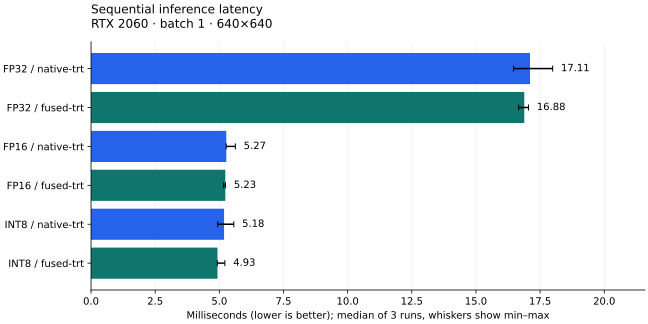
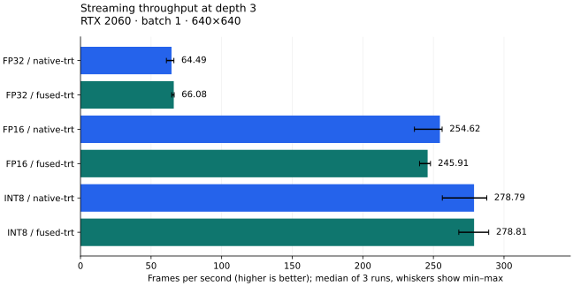

# Deployment evaluation

[Project](../../README.md) · [Interpretation](../RESULTS_ANALYSIS.md) · [Reproduction](../BENCHMARKING.md)

Measured run: `all_20261018_151027_308`. All 120 coordinator jobs completed; source/input
identities were validated at completion. This bundle was exported from verified
saved evidence, not a new inference run. Complete does not mean every parity gate passed.

## Measurement protocol

- NVIDIA GeForce RTX 2060, AMD Ryzen 5 3600 6-Core Processor, native Windows, batch 1, square 640×640.
- 24 quality paths, each using the full prepared 20,000-image test split;
  367,728 targets. This is not an official BDD100K leaderboard evaluation.
- Quality confidence 0.001, maximum 300 detections, common matching/AP code.
- Parity: 64 validation images, seed 42, confidence 0.25; unchanged strict gates.
- Performance: 128 fixed decoded validation images; 50 warmups; three repetitions
  of 300 sequential or 1,000 streaming frames. Stage diagnostics use 100 frames.
- Sequential timing covers decoded BGR pixels through detection objects. Decode,
  initialization, annotation and disk output are excluded. Streaming frame
  residence includes scheduling/backpressure and is not sequential latency.
- Statistics are medians of per-run statistics, not pooled percentiles. FPS is
  completed frames / measured wall time. Run ranges are not confidence intervals.
- Runs resumed after power interruptions; source/model identities remained unchanged.
  GPU clocks were not locked; no statistical significance claim is made.

## Detection quality

Scores use a 0–100 scale. Python rows are artifact-level evaluations; C++ rows
measure the complete corresponding preprocessing/inference/postprocessing path.

| Path | Images | mAP50 | mAP50–95 |
| --- | --- | --- | --- |
| python_pytorch | 20000 | 60.0549 | 34.0161 |
| python_onnx_fp16 | 20000 | 60.0478 | 33.9803 |
| python_onnx_fp32 | 20000 | 60.0549 | 34.0161 |
| python_onnx_int8 | 20000 | 58.5908 | 32.9093 |
| python_engine_fp16 | 20000 | 60.0480 | 34.0144 |
| python_engine_fp32 | 20000 | 60.0549 | 34.0161 |
| python_engine_int8 | 20000 | 58.9281 | 33.2616 |
| python_onnx_allconv_int8 | 20000 | 53.8080 | 28.6010 |
| onnx_fp16__ort-cpu | 20000 | 60.0699 | 33.9823 |
| onnx_fp16__ort-cuda | 20000 | 60.0476 | 33.9803 |
| onnx_fp16__ort-trt | 20000 | 60.0635 | 33.9276 |
| onnx_fp32__ort-cpu | 20000 | 60.0549 | 34.0161 |
| onnx_fp32__ort-cuda | 20000 | 60.0549 | 34.0161 |
| onnx_fp32__ort-trt | 20000 | 60.0549 | 34.0161 |
| onnx_int8__ort-cpu | 20000 | 58.6814 | 32.9284 |
| onnx_int8__ort-cuda | 20000 | 58.5908 | 32.9093 |
| engine_fp16__native-trt | 20000 | 60.0445 | 34.0120 |
| engine_fp16__fused-trt | 20000 | 60.0445 | 34.0120 |
| engine_fp32__native-trt | 20000 | 60.0549 | 34.0161 |
| engine_fp32__fused-trt | 20000 | 60.0549 | 34.0161 |
| engine_int8__native-trt | 20000 | 58.9273 | 33.2609 |
| engine_int8__fused-trt | 20000 | 58.9273 | 33.2609 |
| onnx_allconv_int8__ort-cpu | 20000 | 53.9948 | 28.6619 |
| onnx_allconv_int8__ort-cuda | 20000 | 53.8251 | 28.6131 |

## Sequential latency and streaming throughput

`latency_*` is sequential. The millisecond columns for `throughput_*` describe
frame residence under streaming, not single-frame inference latency. Backend-only
timings and graph-off ablations are separate measurements, not substitutions for
end-to-end results. Every row below has all three repetitions.

| Path | Measurement | Depth | Mean / p50 / p95 (ms) | FPS | FPS range | FPS CV | Runs |
| --- | --- | --- | --- | --- | --- | --- | --- |
| TRT FP16 / fused-trt | latency_e2e_clean | 1 | 5.233 / 5.155 / 5.407 | 191.059 | 190.778–193.614 | 0.81% | 3/3 |
| TRT FP16 / fused-trt | throughput_e2e_clean | 1 | 9.985 / 9.943 / 10.220 | 192.160 | 191.119–193.462 | 0.61% | 3/3 |
| TRT FP16 / fused-trt | throughput_e2e_clean | 2 | 12.592 / 9.320 / 17.073 | 229.891 | 224.981–230.833 | 1.37% | 3/3 |
| TRT FP16 / fused-trt | throughput_e2e_clean | 3 | 15.775 / 12.532 / 23.798 | 245.906 | 240.167–247.921 | 1.64% | 3/3 |
| TRT FP16 / fused-trt | latency_e2e_graph_off | 1 | 5.418 / 5.393 / 5.493 | 184.529 | 179.946–185.228 | 1.57% | 3/3 |
| TRT FP16 / fused-trt | throughput_e2e_graph_off | 3 | 13.736 / 13.561 / 16.082 | 247.057 | 237.476–248.031 | 2.39% | 3/3 |
| TRT FP32 / fused-trt | latency_e2e_clean | 1 | 16.884 / 16.892 / 17.523 | 59.227 | 58.652–60.003 | 1.14% | 3/3 |
| TRT FP32 / fused-trt | throughput_e2e_clean | 1 | 33.554 / 33.647 / 34.552 | 58.791 | 58.413–59.553 | 0.99% | 3/3 |
| TRT FP32 / fused-trt | throughput_e2e_clean | 2 | 46.689 / 43.186 / 55.949 | 63.606 | 62.686–64.218 | 1.21% | 3/3 |
| TRT FP32 / fused-trt | throughput_e2e_clean | 3 | 59.925 / 58.575 / 75.372 | 66.079 | 64.621–66.365 | 1.42% | 3/3 |
| TRT INT8 / fused-trt | latency_e2e_clean | 1 | 4.929 / 4.926 / 4.973 | 202.858 | 191.706–203.227 | 3.29% | 3/3 |
| TRT INT8 / fused-trt | throughput_e2e_clean | 1 | 9.424 / 9.438 / 9.487 | 202.980 | 193.227–203.393 | 2.88% | 3/3 |
| TRT INT8 / fused-trt | throughput_e2e_clean | 2 | 11.375 / 8.417 / 15.434 | 253.746 | 240.244–259.719 | 3.97% | 3/3 |
| TRT INT8 / fused-trt | throughput_e2e_clean | 3 | 13.826 / 11.179 / 20.707 | 278.814 | 267.983–289.171 | 3.80% | 3/3 |
| TRT FP16 / native-trt | latency_e2e_clean | 1 | 5.271 / 5.264 / 5.339 | 189.675 | 177.732–189.859 | 3.74% | 3/3 |
| TRT FP16 / native-trt | throughput_e2e_clean | 1 | 10.571 / 10.554 / 10.722 | 189.008 | 176.797–190.031 | 3.97% | 3/3 |
| TRT FP16 / native-trt | latency_backend_clean | 1 | 4.827 / 4.820 / 4.885 | 189.590 | 179.399–189.797 | 3.19% | 3/3 |
| TRT FP16 / native-trt | throughput_e2e_clean | 3 | 15.690 / 13.083 / 23.037 | 254.615 | 236.540–256.182 | 4.38% | 3/3 |
| TRT FP32 / native-trt | latency_e2e_clean | 1 | 17.107 / 17.147 / 17.781 | 58.452 | 55.581–60.722 | 4.42% | 3/3 |
| TRT FP32 / native-trt | throughput_e2e_clean | 1 | 34.465 / 34.495 / 35.927 | 57.993 | 54.726–59.740 | 4.43% | 3/3 |
| TRT FP32 / native-trt | latency_backend_clean | 1 | 16.863 / 16.817 / 17.544 | 57.948 | 54.486–59.157 | 4.24% | 3/3 |
| TRT FP32 / native-trt | throughput_e2e_clean | 3 | 61.965 / 47.805 / 94.838 | 64.490 | 60.867–66.174 | 4.25% | 3/3 |
| TRT INT8 / native-trt | latency_e2e_clean | 1 | 5.185 / 5.181 / 5.246 | 192.820 | 179.690–202.562 | 5.99% | 3/3 |
| TRT INT8 / native-trt | throughput_e2e_clean | 1 | 10.338 / 10.327 / 10.460 | 193.299 | 179.326–201.697 | 5.90% | 3/3 |
| TRT INT8 / native-trt | latency_backend_clean | 1 | 4.786 / 4.794 / 4.841 | 193.292 | 181.656–201.793 | 5.26% | 3/3 |
| TRT INT8 / native-trt | throughput_e2e_clean | 3 | 14.327 / 11.801 / 20.755 | 278.790 | 256.314–287.825 | 5.92% | 3/3 |
| ONNX FP16 / ort-cuda | latency_e2e_clean | 1 | 12.404 / 12.226 / 13.732 | 80.600 | 76.443–80.813 | 3.11% | 3/3 |
| ONNX FP16 / ort-cuda | throughput_e2e_clean | 1 | 12.201 / 12.223 / 12.387 | 81.950 | 68.185–84.347 | 11.16% | 3/3 |
| ONNX FP16 / ort-cuda | latency_backend_clean | 1 | 11.803 / 11.420 / 13.371 | 81.043 | 76.045–82.331 | 4.16% | 3/3 |
| ONNX FP32 / ort-cuda | latency_e2e_clean | 1 | 29.191 / 29.221 / 29.560 | 34.254 | 31.542–34.341 | 4.77% | 3/3 |
| ONNX FP32 / ort-cuda | throughput_e2e_clean | 1 | 29.705 / 29.545 / 30.743 | 33.661 | 31.392–34.341 | 4.66% | 3/3 |
| ONNX FP32 / ort-cuda | latency_backend_clean | 1 | 29.014 / 28.886 / 29.827 | 33.774 | 31.400–34.321 | 4.68% | 3/3 |
| ONNX ALLCONV_INT8 / ort-cuda | latency_e2e_clean | 1 | 46.015 / 45.918 / 47.632 | 21.731 | 21.023–22.914 | 4.37% | 3/3 |
| ONNX ALLCONV_INT8 / ort-cuda | throughput_e2e_clean | 1 | 46.051 / 45.833 / 48.070 | 21.714 | 21.012–22.861 | 4.27% | 3/3 |
| ONNX ALLCONV_INT8 / ort-cuda | latency_backend_clean | 1 | 42.878 / 42.827 / 43.346 | 22.913 | 20.978–23.382 | 5.68% | 3/3 |
| ONNX INT8 / ort-cuda | latency_e2e_clean | 1 | 42.921 / 42.878 / 43.982 | 23.297 | 22.144–24.171 | 4.38% | 3/3 |
| ONNX INT8 / ort-cuda | throughput_e2e_clean | 1 | 43.084 / 43.135 / 44.194 | 23.209 | 22.097–23.891 | 3.93% | 3/3 |
| ONNX INT8 / ort-cuda | latency_backend_clean | 1 | 42.831 / 42.857 / 44.148 | 22.967 | 22.142–24.069 | 4.19% | 3/3 |
| ONNX FP16 / ort-trt | latency_e2e_clean | 1 | 5.231 / 5.123 / 6.167 | 191.123 | 181.850–195.978 | 3.79% | 3/3 |
| ONNX FP16 / ort-trt | throughput_e2e_clean | 1 | 5.300 / 5.093 / 6.265 | 188.629 | 182.714–196.790 | 3.73% | 3/3 |
| ONNX FP16 / ort-trt | latency_backend_clean | 1 | 4.774 / 4.559 / 5.749 | 190.399 | 184.774–198.746 | 3.67% | 3/3 |
| ONNX FP32 / ort-trt | latency_e2e_clean | 1 | 17.993 / 17.960 / 18.610 | 55.570 | 53.111–57.749 | 4.18% | 3/3 |
| ONNX FP32 / ort-trt | throughput_e2e_clean | 1 | 18.034 / 17.999 / 18.593 | 55.445 | 52.202–56.742 | 4.27% | 3/3 |
| ONNX FP32 / ort-trt | latency_backend_clean | 1 | 17.651 / 17.606 / 18.241 | 55.019 | 52.732–56.753 | 3.68% | 3/3 |
| ONNX FP16 / ort-cpu | latency_e2e_clean | 1 | 259.711 / 259.837 / 275.458 | 3.850 | 3.823–4.433 | 8.53% | 3/3 |
| ONNX FP16 / ort-cpu | throughput_e2e_clean | 1 | 260.332 / 260.767 / 275.655 | 3.841 | 3.687–3.844 | 2.37% | 3/3 |
| ONNX FP16 / ort-cpu | latency_backend_clean | 1 | 259.877 / 260.181 / 275.519 | 3.838 | 3.441–3.851 | 6.27% | 3/3 |
| ONNX FP32 / ort-cpu | latency_e2e_clean | 1 | 253.110 / 251.534 / 269.102 | 3.951 | 3.949–3.973 | 0.33% | 3/3 |
| ONNX FP32 / ort-cpu | throughput_e2e_clean | 1 | 251.155 / 251.872 / 267.392 | 3.982 | 3.978–3.992 | 0.19% | 3/3 |
| ONNX FP32 / ort-cpu | latency_backend_clean | 1 | 252.335 / 252.636 / 267.671 | 3.951 | 3.940–4.123 | 2.56% | 3/3 |
| ONNX ALLCONV_INT8 / ort-cpu | latency_e2e_clean | 1 | 451.542 / 451.393 / 470.592 | 2.215 | 2.207–2.238 | 0.72% | 3/3 |
| ONNX ALLCONV_INT8 / ort-cpu | throughput_e2e_clean | 1 | 453.192 / 453.174 / 471.564 | 2.207 | 2.206–2.514 | 7.70% | 3/3 |
| ONNX ALLCONV_INT8 / ort-cpu | latency_backend_clean | 1 | 450.985 / 451.703 / 469.529 | 2.212 | 2.205–2.442 | 5.90% | 3/3 |
| ONNX INT8 / ort-cpu | latency_e2e_clean | 1 | 432.156 / 432.529 / 450.918 | 2.314 | 2.305–2.414 | 2.57% | 3/3 |
| ONNX INT8 / ort-cpu | throughput_e2e_clean | 1 | 432.987 / 433.058 / 451.645 | 2.310 | 2.308–2.540 | 5.59% | 3/3 |
| ONNX INT8 / ort-cpu | latency_backend_clean | 1 | 431.621 / 431.489 / 449.827 | 2.311 | 2.093–2.323 | 5.76% | 3/3 |

PyTorch API sequential mean/p50/p95: **29.384 / 28.398 / 36.102 ms**;
34.031 FPS. This separately synchronized Python path includes API overhead.

## Strict parity

22 comparisons pass; 20 fail. Same-artifact parity, PyTorch agreement and dataset
mAP are distinct properties. See [gate definitions](fp16-correctness.md).

| Comparison | Images matched | Gate |
| --- | --- | --- |
| compare_onnx_fp16__ort-cpu_same_artifact | 57/64 | FAIL |
| compare_onnx_fp16__ort-cpu_pytorch | 51/64 | FAIL |
| compare_onnx_fp16__ort-cuda_same_artifact | 64/64 | PASS |
| compare_onnx_fp16__ort-cuda_pytorch | 46/64 | FAIL |
| compare_onnx_fp16__ort-trt_same_artifact | 48/64 | FAIL |
| compare_onnx_fp16__ort-trt_pytorch | 50/64 | FAIL |
| compare_onnx_fp32__ort-cpu_same_artifact | 64/64 | PASS |
| compare_onnx_fp32__ort-cpu_pytorch | 64/64 | PASS |
| compare_onnx_fp32__ort-cuda_same_artifact | 64/64 | PASS |
| compare_onnx_fp32__ort-cuda_pytorch | 64/64 | PASS |
| compare_onnx_fp32__ort-trt_same_artifact | 64/64 | PASS |
| compare_onnx_fp32__ort-trt_pytorch | 64/64 | PASS |
| compare_onnx_int8__ort-cpu_same_artifact | 1/64 | FAIL |
| compare_onnx_int8__ort-cpu_pytorch | 0/64 | FAIL |
| compare_onnx_int8__ort-cuda_same_artifact | 64/64 | PASS |
| compare_onnx_int8__ort-cuda_pytorch | 1/64 | FAIL |
| compare_engine_fp16__native-trt_same_artifact | 64/64 | PASS |
| compare_engine_fp16__native-trt_pytorch | 61/64 | FAIL |
| compare_engine_fp16__fused-trt_same_artifact | 64/64 | PASS |
| compare_engine_fp16__fused-trt_pytorch | 61/64 | FAIL |
| compare_engine_fp32__native-trt_same_artifact | 64/64 | PASS |
| compare_engine_fp32__native-trt_pytorch | 64/64 | PASS |
| compare_engine_fp32__fused-trt_same_artifact | 64/64 | PASS |
| compare_engine_fp32__fused-trt_pytorch | 64/64 | PASS |
| compare_engine_int8__native-trt_same_artifact | 64/64 | PASS |
| compare_engine_int8__native-trt_pytorch | 1/64 | FAIL |
| compare_engine_int8__fused-trt_same_artifact | 64/64 | PASS |
| compare_engine_int8__fused-trt_pytorch | 1/64 | FAIL |
| compare_onnx_allconv_int8__ort-cpu_same_artifact | 1/64 | FAIL |
| compare_onnx_allconv_int8__ort-cpu_pytorch | 0/64 | FAIL |
| compare_onnx_allconv_int8__ort-cuda_same_artifact | 64/64 | PASS |
| compare_onnx_allconv_int8__ort-cuda_pytorch | 0/64 | FAIL |
| compare_python_onnx_fp16_pytorch | 46/64 | FAIL |
| compare_python_onnx_fp32_pytorch | 64/64 | PASS |
| compare_python_onnx_int8_pytorch | 1/64 | FAIL |
| compare_python_engine_fp16_pytorch | 61/64 | FAIL |
| compare_python_engine_fp32_pytorch | 64/64 | PASS |
| compare_python_engine_int8_pytorch | 1/64 | FAIL |
| compare_python_onnx_allconv_int8_pytorch | 0/64 | FAIL |
| compare_engine_fp16__fused-trt_native | 64/64 | PASS |
| compare_engine_fp32__fused-trt_native | 64/64 | PASS |
| compare_engine_int8__fused-trt_native | 64/64 | PASS |

## Execution coverage and limitations

All 16 supported C++ paths completed inference and performance measurement.
Of 202 performance executions, 200 passed. Two INT8 ONNX / ORT TensorRT smoke
checks were rejected by project routing policy; no timing is assigned to them.
This does not establish a universal TensorRT limitation. Native TensorRT INT8
uses the separately built engine and completes normally.

Native depth-3 runs recorded three active workers for every precision and
repetition. This verifies concurrent host workers, not guaranteed GPU kernel overlap.
Docker execution, remote CI status and external camera/device-input throughput
are not established by this native decoded-image benchmark. No QAT was run.

## Annotated outputs

The first saved image from each named smoke run is shown below. Selection is
fixed, not based on visual quality. These examples demonstrate output generation;
accuracy is established by the full test split above. Source imagery remains
subject to BDD100K's dataset terms.

| Fused FP16 | Native FP16 | Fused INT8 |
|---|---|---|
|  |  |  |

## Evidence files

- [accuracy.csv](accuracy.csv) / [accuracy.json](accuracy.json): 24 quality paths, with per-class metrics in JSON.
- [parity.csv](parity.csv) / [parity.json](parity.json): every strict result and its thresholds.
- [summary.csv](summary.csv) / [runs.csv](runs.csv): aggregate and per-execution timing records.
- [performance.json](performance.json): variability, stage diagnostics, failures and PyTorch timing.
- [provenance.json](provenance.json): artifact/source hashes, versions, settings and source-manifest hashes.
- [validation.json](validation.json): saved validation outcomes and scope.
- [examples.json](examples.json): image selection and checksums.
- [SHA256SUMS.txt](SHA256SUMS.txt): generated-bundle checksums (identity, not independent reproduction).

Raw predictions, per-frame samples, logs, engines and caches remain in the ignored
local run directory. Paths in provenance identify that local evidence; they are
not downloadable GitHub assets. No model weights or dataset download is bundled.
